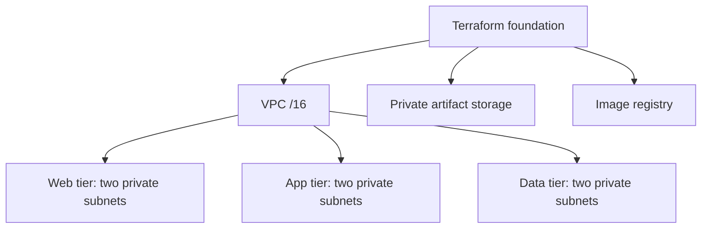

# Terraform AWS Three-Tier Foundation

Independent reusable AWS infrastructure module for a private FinTech-style lab. It creates a VPC design across two availability zones with web, application and data tiers, private route associations, encrypted/versioned S3 artifact storage with public access blocked, and an immutable ECR repository with image scanning configured.



The root requires an explicit environment (`dev`, `qa` or `prod`), project slug, IPv4 CIDR and two distinct availability zones. Names and tags include the environment. Separate AWS accounts, backends and non-overlapping CIDRs are needed for true account isolation.

## No-cloud local validation

```bash
terraform fmt -check -recursive
terraform init -backend=false -input=false
terraform validate
terraform test
```

Verified 26 November 2026: AWS provider 5.100.0, all three mocked plan tests passed, including six distinct private subnets, public storage block, immutable registry, environment tags, and negative input validation. No AWS credentials, real plans or applies were used.

This foundation deliberately has no external routing, NAT, CDN, load balancer, compute, EKS, managed database or secret infrastructure. Those require separate design and cost approval. S3 and ECR are AWS services, not actually placed inside the VPC by this module.
